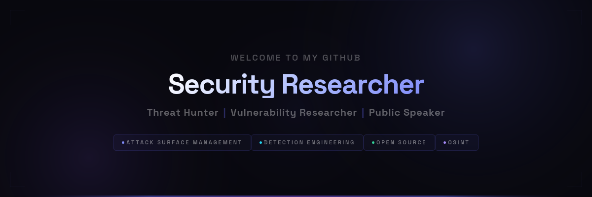

	

Rishi is a vulnerability researcher and threat intelligence specialist in London, working on detection research — Nuclei templates and internet-wide scans — cited or adopted by national cyber authorities and CERT teams.

### Open Source

- **ProjectDiscovery Pioneer** — authored 950+ Nuclei detection templates ([rxerium-templates](https://github.com/rxerium/rxerium-templates))
- **OWASP Member** — contributor to Amass and Nettacker; supported the Amass workshop at DEF CON 33
- Detection scripts adopted by national CERT teams

### Stats

<!-- STATS:START -->
| Metric | Count |
|---|---|
| Nuclei templates | 950+ |
| CVEs disclosed | 52 (6 Critical / 34 High) |
| Conference talks | 20+ |
| Government and CERT citations | 10+ |

_Stats synced automatically from rxerium.com._
<!-- STATS:END -->

### Talks

- **UK Parliament** — briefing on vulnerability research and supply chain security
- **DEF CON 34** — Recon Village talk and two Social Engineering Village workshops
- **DEF CON 33** — Red Team Village: DNS OSINT Techniques for Product and Service Discovery
- **SecTor Toronto** — Ghost in the Hiring Machine
- **OWASP London** — DNS OSINT Techniques for Product and Service Discovery
- **BSides** — Budapest, Prague, Luxembourg, Las Vegas, Cymru, Porto and more

### Research & Blogs

- [Detecting OpenClaw Gateways with Nuclei over mDNS](https://rxerium.com/posts/hunting-exposed-openclaw-instances-with-nuclei/)
- [Salesloft Drift Supply Chain Detection through DNS OSINT Techniques](https://rxerium.com/posts/dns-osint-techniques/)
- [Internal Security Detection from an External Lens](https://rxerium.com/posts/internal-security-detection/)
- [Fishing for Phishing with Nuclei Templates](https://projectdiscovery.io/blog/phishing-templates)

### Recognition & Media

- **Government & CERT** — cited or adopted by NCSC (UK), CERT Polska, NIST/NVD, INCIBE, CIRCL, Cal-CSIC, Government of Vietnam
- **Industry** — cited by SonicWall, Qualys, Censys, ReSecurity, Coalition, Intruder, Black Kite, Feedly and more
- **Media** — GBHackers, The Hacker News, Cybersecurity News, Security Online, CyberPress and more

### Connect

- **Website**: [rxerium.com](https://rxerium.com)
- **X**: [@rxerium](https://x.com/rxerium)
- **Bluesky**: [@rxerium.com](https://bsky.app/profile/rxerium.com)
- **Mastodon**: [@rxerium@infosec.exchange](https://infosec.exchange/@rxerium)
- **PGP**: [public key](misc/email_PGP.md) — rishi@rxerium.com

	

